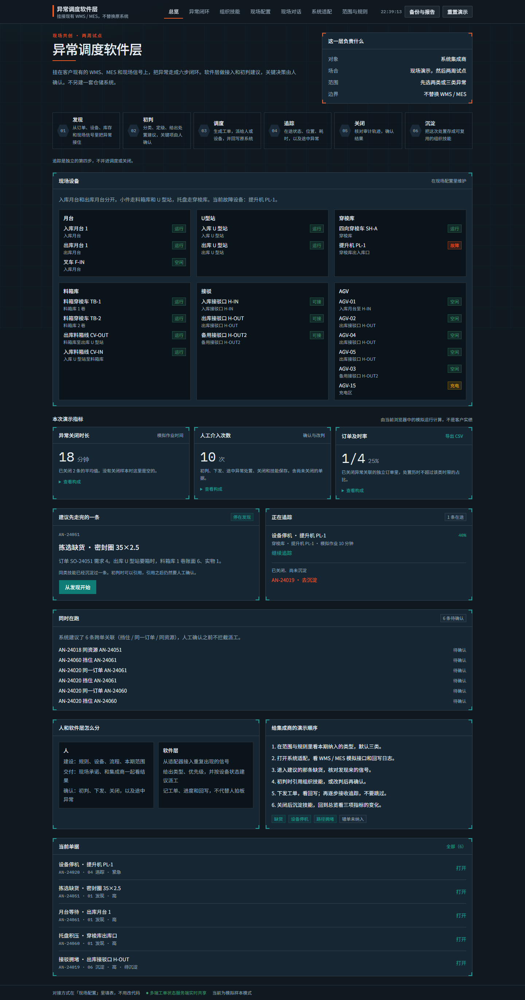
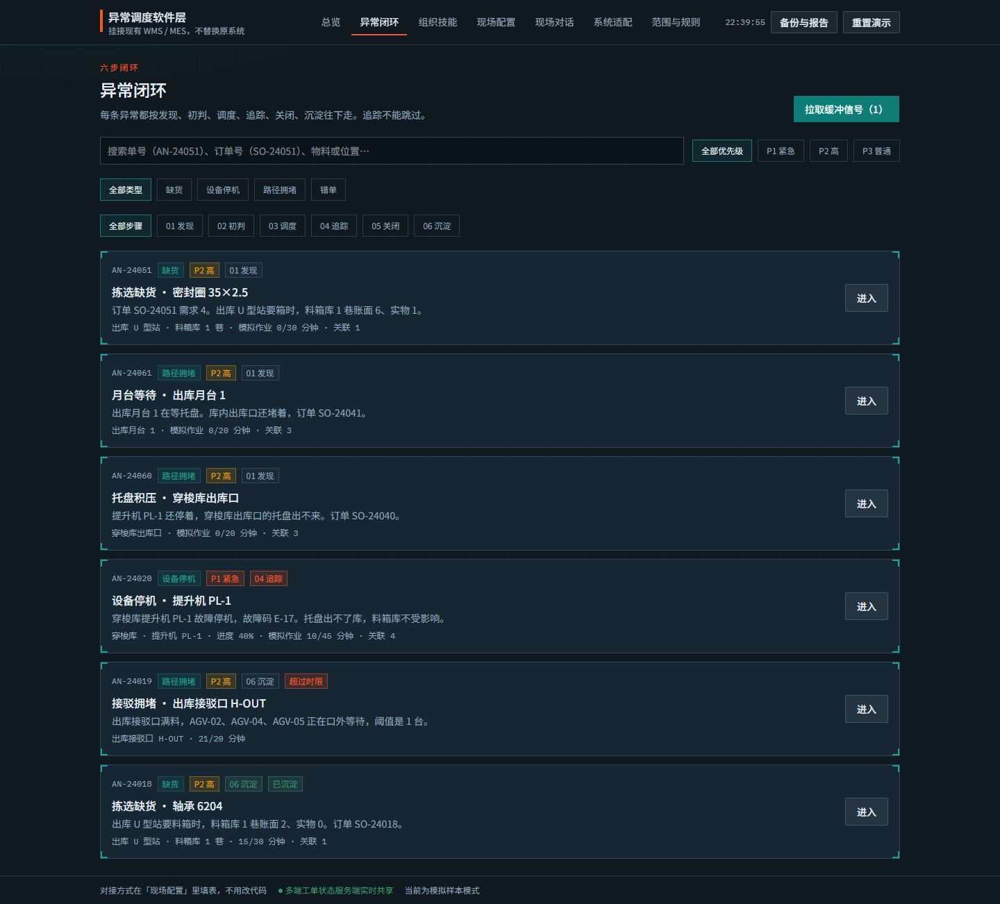
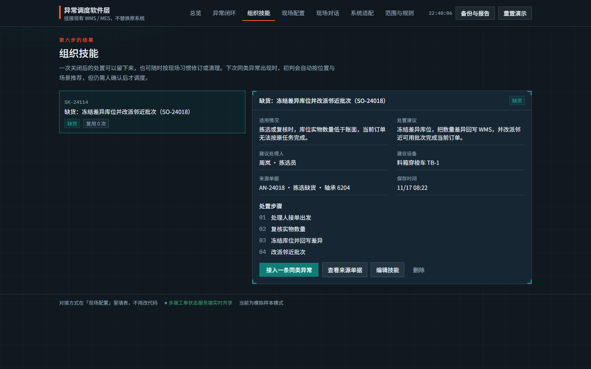
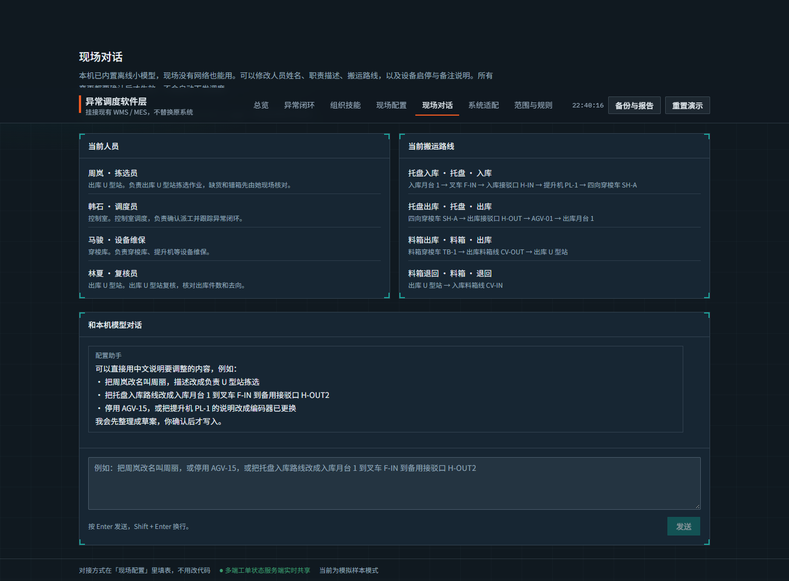
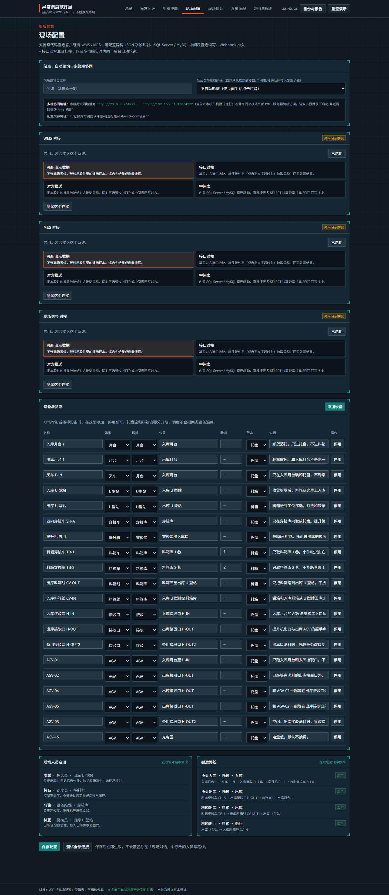
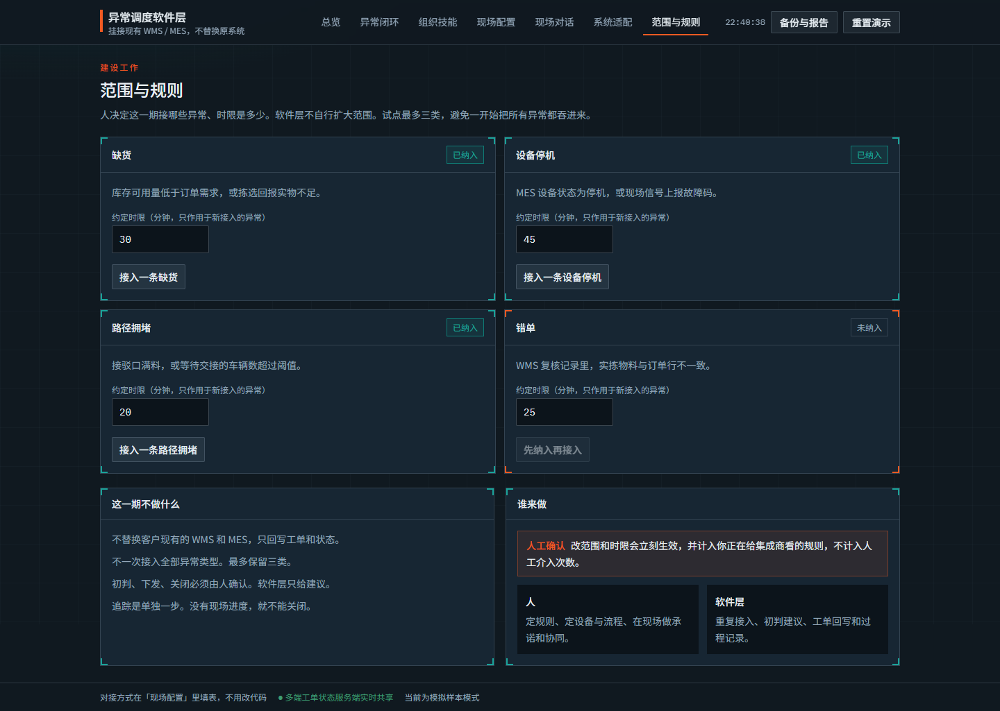
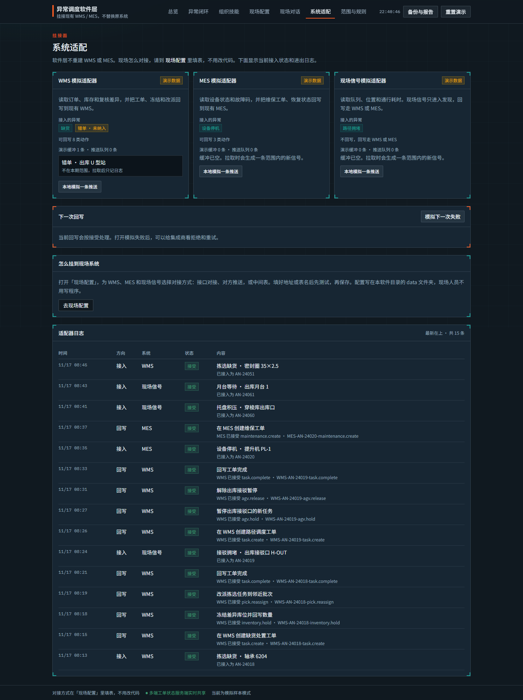

# 智能仓储+智能物流+智能工厂 异常处理软件

挂在客户已有 WMS / MES 和现场信号上的异常调度软件层。不替换原来的仓储或制造系统，只补一层异常闭环。

> 拿到文件夹即可在 Windows 上直接运行，无需安装 Node.js，也无需配置开发环境。

## 作者的话

失业人员头铁做的。哪家公司看上了给口饭吃，请联系：QQ 1229638517  GitHub [@tomoe1-1](https://github.com/tomoe1-1) 私信，或在本仓库开 Issue。

后续如果出现现场人员做不了停机的，不必半夜爬起床赶到现场处理——软件层负责重复接入、初判建议与进度追踪，关键调度仍由人工确认。

## 它解决什么

异常闭环固定六步，顺序不能并掉：

1. **发现** — 从适配器接入信号，不用人工录入
2. **初判** — 给出类型、优先级和建议，可引用已沉淀技能
3. **调度** — 按设备约束派车/派人，选错设备会被拦住
4. **追踪** — 接收现场回报，没到终点不能关闭
5. **关闭** — 核对审计轨迹与时限后人工确认
6. **沉淀** — 把本次处置保存成组织技能，供同类异常优先推荐

本期默认纳入三类：缺货、设备停机、路径拥堵。错单留在适配器缓冲里，范围外信号不会进闭环。

## 快速开始

1. 把整个仓库文件夹拷到 Windows 电脑上（**不要只拷其中某一个文件**）。
2. 双击 `仓储异常调度.exe`。
3. 软件会自动打开浏览器，地址是 <http://127.0.0.1:4721>。
4. 用完后关闭标题为「仓储异常调度软件层」的窗口，软件即退出。

若 exe 被系统拦截，可改用 `启动.bat`（单机模式，绑定 127.0.0.1）。
若需多台电脑/车间平板协同，或接收局域网另一台 WMS/MES 服务器的推送，双击 `启动-局域网联调版.bat`（开放 0.0.0.0:4721 并自动打印本机局域网地址）。

> 本机 4721 端口需要空闲。若被占用，软件会提示或打开已有页面。运行异常可查看 `runtime.log`。

## 功能说明

**多终端协同**
工单状态机、追踪进度与组织技能已支持服务端实时落盘共享（`data/app-state.json`）。控制室电脑与车间巡检平板访问同一地址即可实时看到最新在途进度。

**现场配置（不用改代码）**
页头「现场配置」里填表即可完成对接：WMS / MES / 现场信号可选演示数据、接口对接、对方推送（HTTP 或数据库回写）、中间表（内置 SQL Server / MySQL 直连读写驱动，免装数据库客户端）。客户字段名不同可填「异构字段映射」。可开启每 10~60 秒后台自动拉取新异常。点「查看对接规范 / 建表 DDL」可一键复制或下载建表脚本、Webhook curl 示例与 HTTP 接口契约。连接可先「测试这个连接」再保存，已保存密码与令牌自动脱敏。

**现场对话与组织技能**
页头「现场对话」可用中文说明要改的人员姓名、职责、搬运路线，或停用/启用设备、修改备注；软件先给草案，点「确认写入」后才生效，不会自动改现场系统。页头「组织技能」可随时修订或删除已沉淀技能；同类异常初判时按巷道与场景优先推荐。

**本地离线模型**
`runtime/model` 内置离线小模型，`runtime/llama` 是本机推理程序，启动时在本机加载，不联网。初判步骤可点「请本机模型再看一眼」，模型只写建议，关键调度仍需人工确认。这两个目录不要删。

**备份与报告**
页头「备份与报告」可导出运行备份（.json，用于换电脑或交接班导入恢复），一键导出试点明细表（.csv，Excel 可直接打开）与试点汇报文档（.md）。「重置演示」回到预置样本，不会清空现场配置中保存的连接参数、设备及人员名册。

**指标**
异常关闭时长、人工介入次数、订单及时率（按独立订单号去重）均按当前这次模拟运行计算，页面注明不是客户实绩。

## 页面展示

**总览** — 六步闭环、设备状态、三项指标与最近动态。



**异常闭环** — 工单列表、类型/步骤/优先级筛选、六步状态流转。



**组织技能** — 已沉淀技能，支持修订与删除。



**现场对话** — 中文描述变更，先出草案、确认后写入。



**现场配置** — WMS/MES/现场信号对接、异构字段映射、设备与人员名册。



**范围与规则** — 纳入的异常类型与时限。



**系统适配** — 模拟适配器、接口与回写日志。



## 目录结构

```text
仓储异常调度软件层-可运行版/
├── 仓储异常调度.exe            # 双击启动
├── 启动.bat                    # 单机模式备用启动脚本
├── 启动-局域网联调版.bat        # 多终端/接收推送模式
├── 使用说明.txt                # 完整使用说明
├── runtime/
│   ├── node/                   # 内置 Node 运行时
│   ├── llama/                  # 本机推理程序
│   └── model/                  # 离线小模型（Git LFS 托管）
├── data/                       # 运行状态与现场配置
├── app/
│   ├── server.js               # 启动入口
│   ├── .next/                  # 编译后的可运行产物
│   └── node_modules/           # 运行依赖
└── screenshots/                # 页面展示截图
```

> `runtime/model` 下的 `.gguf` 模型文件通过 Git LFS 托管（约 469 MB）。克隆时需安装 git-lfs；只想体验无需本地模型的功能时，也可跳过该文件的下载，软件仍可正常运行。

## 说明

- 演示名册里的人员和设备不是真实班组；仓库位置、订单号和故障码都是为把闭环走通而准备的样本。
- 真正连上现场后，异常按配置的方式接入与回写；回写被拒时步骤不会往前虚报成功，关键调度仍需人工确认。
